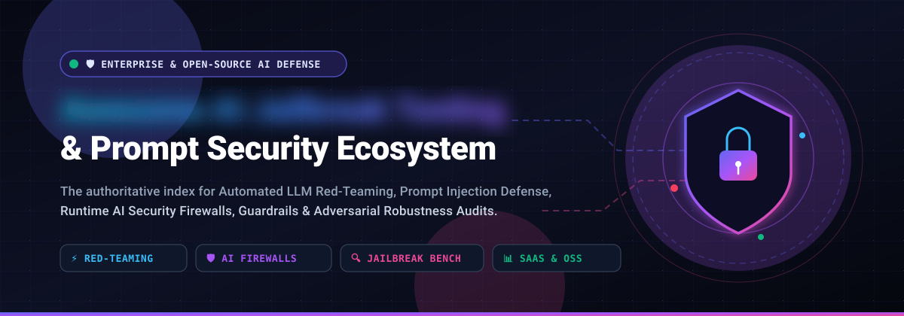
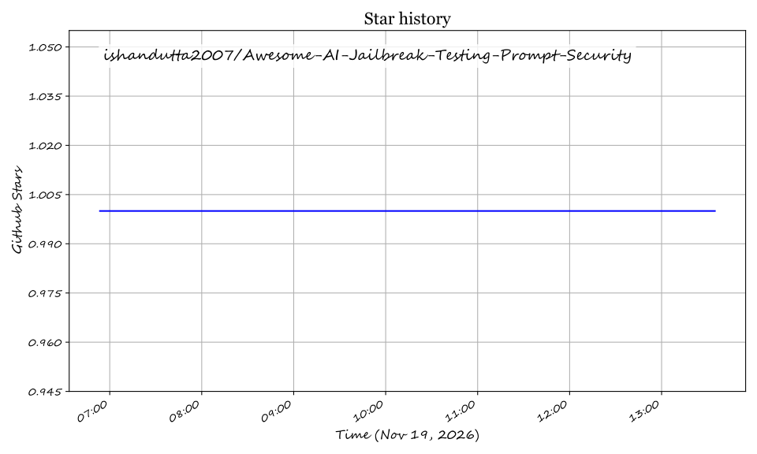

# Awesome AI Jailbreak Testing & Prompt Security Ecosystem 🛡️⚡

## 🚀 Top AI Jailbreak Testing, Automated Red-Teaming & Prompt Security Ecosystem

**Curated Catalog of Enterprise SaaS Platforms & Open-Source Security Tools**  
*Comprehensive Index for Automated LLM Red-Teaming, Prompt Injection & Jailbreak Testing, AI Firewalls, Guardrails, System-Prompt Auditing & Adversarial Robustness*  

**Last updated: November 2026**

This repository provides an authoritative, SEO-optimized knowledge graph of top **SaaS platforms** and **open-source repositories** designed for **AI Jailbreak Testing & Prompt Security**. As large language models (LLMs) and multi-turn autonomous AI agents enter enterprise production, securing model inference against direct/indirect prompt injection, jailbreaks, system-prompt extraction, model evasion, and sensitive data leakage has become a mission-critical cybersecurity requirement.

- 🛡️ **Defensive Guardrails**: Real-time prompt firewalls, PII anonymization, and LLM input/output moderation.
- 🎯 **Adversarial Red-Teaming**: Automated jailbreak fuzzing, token-level gradient perturbations, and multi-turn attack orchestration.
- 🔍 **Transparency & Evaluation**: System-prompt extraction analysis, benchmark suites, and compliance validation (OWASP Top 10 for LLMs, NIST AI RMF, EU AI Act).

Contributions are warmly welcomed! Please read the [Contribution Guide](#-how-to-contribute) to add or update projects.

---

## 📖 Table of Contents

- [📊 Sector Overview & Market Dynamics](#-sector-overview--market-dynamics)
- [☁️ SaaS/Hosted Platforms](#️-saashosted-platforms)
- [🔓 Open-Source GitHub Projects](#-open-source-github-projects)
- [🤝 How to Contribute](#-how-to-contribute)
- [💖 Support & Sponsorship](#-support--sponsorship)
- [📈 Star History](#-star-history)
- [⚠️ Disclaimer](#️-disclaimer)

---

## 📊 Sector Overview & Market Dynamics

The AI Trust, Risk, and Security Management (AI TRiSM) and generative AI security market is projected to expand from **~$3.1 billion in 2026** to over **$13.8 billion by 2030** (growing at a **~32% CAGR**), within a broader AI cybersecurity market on track to surpass **$86 billion to $93 billion by 2030**.

The sector is currently **moderately fragmented and rapidly consolidating** rather than a winner-take-all environment: specialized pure-play innovators (such as Lakera, Robust Intelligence, Protect AI, Fiddler, and TrojAI) pioneer novel defense vectors, which are systematically acquired by tier-1 cybersecurity conglomerates (Cisco, Palo Alto Networks, Check Point, CrowdStrike, and A10 Networks) to embed runtime AI firewalls into broader enterprise security and SASE fabrics.

---

## ☁️ SaaS/Hosted Platforms

| Platform | Valuation / Size | Starting Pricing | Free Tier / Trial Limits | Description |
| :--- | :--- | :--- | :--- | :--- |
| **[Cisco AI Defense](https://cisco.com)** *(formerly Robust Intelligence)* | **$375B+** *(Parent Market Cap; RI acquired for ~$400M)* | **$50,000/yr** *(AWS/Azure Marketplace private offer baseline; enterprise contract packages)* | **Free Explorer Edition** *(Self-serve access for developer scanning & red-teaming; 30-day guided enterprise PoC available)* | Enterprise AI validation and runtime protection suite providing automated algorithmic red-teaming, jailbreak stress-testing, and real-time runtime guardrails. |
| **[Protect AI](https://protectai.com)** *(Guardian & Layer)* | **$260B+** *(Parent Market Cap; acquired by Palo Alto Networks for ~$700M)* | **$30,000/yr** *(AWS Marketplace annual enterprise license baseline; metered per scanning dimension)* | **14 to 30 days** *(Custom enterprise proof-of-concept/pilot via sales; free MLSecOps foundation tools)* | Enterprise AI security platform offering real-time prompt firewalling, ML supply-chain scanning, and continuous automated red-teaming for generative AI apps. |
| **[Lakera Guard](https://lakera.ai)** | **$15B+** *(Parent Market Cap; acquired by Check Point for ~$300M)* | **$0.0015/request** *(or $250/mo starter; custom volume plans for enterprise)* | **Free forever: 10,000 requests/mo** *(Up to 8k tokens context/request, full API & dashboard access)* | Ultra-low-latency real-time AI security firewall protecting LLM applications and agents against prompt injections, jailbreaks, system-prompt leaks, and toxic content via API. |
| **[TrojAI](https://troj.ai)** | **$2.1B** *(Parent Market Cap; acquired by A10 Networks for undisclosed valuation; raised $9.1M)* | **$1,500/mo** *(Annual subscription starting package via A10 Networks / Azure Marketplace)* | **30-day free trial** *(Full access to A10 Defend / TrojAI Detect & Defend evaluation environment upon request)* | Enterprise AI security platform specializing in automated red-teaming, adversarial robustness testing, and real-time firewall protection against prompt injection and data exfiltration. |
| **[HiddenLayer](https://hiddenlayer.com)** | **$500M+** *(Valuation est.; $156M total funding raised including $100M Series B)* | **$500/mo** *(Baseline scanning tier; AWS Marketplace enterprise contracts up to $5M/yr)* | **14-day guided PoC** *(Enterprise pilot with model scanner community evaluation access)* | Enterprise AI security platform delivering real-time adversarial attack detection, prompt injection monitoring, model scanning, and automated AI red-teaming. |
| **[Fiddler AI](https://fiddler.ai)** *(Fiddler Guardrails)* | **$400M** *(Acquisition valuation by CrowdStrike; $100M total venture funding raised)* | **$0.002/trace** *(Developer Tier pay-as-you-go; custom enterprise deployment plans)* | **Free forever: Unlimited Real-Time Guardrails** *(Centor Model safety/jailbreak/injection enforcement; traces excluded)* | Enterprise AI observability and governance platform offering sub-100ms jailbreak, safety, PII, and faithfulness guardrails alongside drift monitoring. |
| **[Patronus AI](https://patronus.ai)** | **$250M+** *(Valuation est.; $70M total funding raised including $50M Series B)* | **$10 per 1,000 evaluator calls** *(Pay-as-you-go API; custom enterprise agreements)* | **Free forever: 2 projects & 5 experiments/project** *(Includes $10 free API credits, 2-week trace retention)* | Automated AI safety and evaluation platform featuring adversarial test generation, specialized hallucination/safety detection models, and enterprise policy benchmarking. |
| **[Mindgard](https://mindgard.ai)** | **$120M+** *(Valuation est.; $42M total funding raised including $30M Series A)* | **$1,200/mo** *(Annual baseline contract; custom quotes based on models & agents tested)* | **Free forever: Mindgard AI Security Labs** *(Free community CLI & web sandbox for individual model red-teaming; 14-day enterprise PoC)* | Continuous automated AI red-teaming and security testing platform uncovering jailbreaks, evasion attacks, model inversion, and data poisoning across LLMs and multimodal systems. |
| **[Vigil AI / Promptfoo Enterprise](https://promptfoo.dev)** | **$86M** *(Acquired by OpenAI in 2026; $23.6M funding raised prior to acquisition)* | **$500/mo** *(Team/Enterprise hosted dashboard; custom enterprise tier)* | **Free forever: 10,000 probes/mo** *(Open-source CLI is 100% free; includes community evaluation engine & vulnerability scanner)* | Enterprise continuous AI red-teaming and vulnerability management platform automating OWASP Top 10 for LLMs testing, compliance reporting, and regression gating. |
| **[Arthur Shield](https://arthur.ai)** *(Arthur AI)* | **$45M – $168M** *(Valuation range; $42M Series B funding; est. $8M+ ARR)* | **$60/mo** *(Premium Tier; covers up to 100 use cases & 30-day retention; custom enterprise)* | **Free forever: Up to 4 use cases** *(Core LLM firewall/observability metrics, unlimited seats, 7-day retention)* | Real-time LLM firewall and observability suite providing prompt injection detection, PII/sensitive data filtering, hallucination scoring, and toxicity guardrails. |

---

## 🔓 Open-Source GitHub Projects

*Sorted by GitHub Stars_Count (Descending)*

- **[elder-plinius/CL4R1T4S](https://github.com/elder-plinius/CL4R1T4S)**   
  *Open-source AI transparency and adversarial prompt-security repository documenting extracted frontier model system prompts, agentic tool schemas, and guardrail architectures for alignment and safety audits.*

- **[promptfoo/promptfoo](https://github.com/promptfoo/promptfoo)**   
  *Industry-leading open-source (`MIT`) CLI and testing framework featuring an automated adversarial red-teaming engine (`promptfoo redteam`) that generates adaptive jailbreaks, indirect injections, SSRF, and PII-exfiltration probes in CI/CD pipelines.*

- **[elder-plinius/L1B3RT4S](https://github.com/elder-plinius/L1B3RT4S)**   
  *Renowned adversarial jailbreak research collection cataloging prompt-injection archetypes, universal bypass payloads, and multi-turn jailbreak mechanisms across proprietary and open-weights models.*

- **[confident-ai/deepeval](https://github.com/confident-ai/deepeval)**   
  *The open-source (`Apache-2.0`) LLM evaluation framework providing production-grade red-teaming, jailbreak resistance metrics, hallucination scoring, toxicity grading, and regression testing for LLM agents.*

- **[NVIDIA/garak](https://github.com/NVIDIA/garak)**   
  *The industry-standard open-source (`Apache-2.0`) LLM vulnerability scanner from NVIDIA that probes models and endpoints for jailbreaks, prompt injections, encoding bypasses, hallucination, and data leakage.*

- **[guardrails-ai/guardrails](https://github.com/guardrails-ai/guardrails)**   
  *Popular open-source (`Apache-2.0`) framework and community validator Hub for enforcing runtime structural, semantic, PII, hallucination, and prompt-injection guardrails on LLM inputs and outputs.*

- **[NVIDIA/NeMo-Guardrails](https://github.com/NVIDIA/NeMo-Guardrails)**   
  *Flagship open-source (`Apache-2.0`) programmable guardrail toolkit using Colang to enforce dialog flows, topical boundaries, jailbreak defenses, and tool-execution guardrails on LLM systems.*

- **[Giskard-AI/giskard](https://github.com/Giskard-AI/giskard)**   
  *Open-source (`Apache-2.0`) automated testing and red-teaming scanner for LLM agents and RAG applications, probing for prompt injection, sensitive data leakage, sycophancy, and hallucination.*

- **[microsoft/PyRIT](https://github.com/microsoft/PyRIT)**   
  *Microsoft AI Red Team's Python Risk Identification Tool for generative AI (`MIT`), automating multi-turn adversarial jailbreak campaigns, adaptive attack converters (Crescendo, Skeleton Key), and scoring.*

- **[llm-attacks/llm-attacks](https://github.com/llm-attacks/llm-attacks)**   
  *Official implementation of Universal and Transferable Adversarial Attacks on Aligned Language Models (GCG - Greedy Coordinate Gradient), generating universal adversarial suffix jailbreaks.*

- **[meta-llama/PurpleLlama](https://github.com/meta-llama/PurpleLlama)**   
  *Meta's open-source cybersecurity and prompt-security benchmark suite (`CyberSecEval`), featuring the weights and inference code for `Prompt Guard` and `Llama Guard` safety classifiers.*

- **[UKGovernmentBEIS/inspect_ai](https://github.com/UKGovernmentBEIS/inspect_ai)**   
  *Open-source (`MIT`) framework developed by the UK AI Security Institute (AISI) for rigorous frontier model evaluation, cyber-offense benchmarks, agentic capabilities, and safety guardrails.*

- **[protectai/llm-guard](https://github.com/protectai/llm-guard)**   
  *Comprehensive open-source (`MIT`) security toolkit by Protect AI providing production-ready scanners for prompt injection, secret keys, sensitive PII anonymization, and output toxicity filtering.*

- **[confident-ai/deepteam](https://github.com/confident-ai/deepteam)**   
  *Open-source (`Apache-2.0`) automated LLM red-teaming framework engineered to simulate 40+ attack vectors including jailbreaking, prompt probing, BOLA, SSRF, and excessive agentic authority.*

- **[yueliu1999/Awesome-Jailbreak-on-LLMs](https://github.com/yueliu1999/Awesome-Jailbreak-on-LLMs)**   
  *Comprehensive curated research repository tracking seminal academic papers, threat models, empirical attack datasets, and defensive mitigation taxonomies for LLM jailbreaking.*

- **[protectai/rebuff](https://github.com/protectai/rebuff)**   
  *Multi-layered prompt-injection detection engine combining vector similarity heuristics, dedicated heuristic filters, canary tokens, and auxiliary LLM evaluation.*

- **[centerforaisafety/HarmBench](https://github.com/centerforaisafety/HarmBench)**   
  *Standardized evaluation benchmark from the Center for AI Safety for automated red-teaming and robust refusal verification across 18+ adversarial attack algorithms and 500+ functional harm indicators.*

- **[ethz-spylab/agentdojo](https://github.com/ethz-spylab/agentdojo)**   
  *Dynamic evaluation benchmark from ETH Zurich specifically engineered to audit tool-calling AI agents against direct and indirect prompt injection attacks.*

- **[RobustBench/robustbench](https://github.com/RobustBench/robustbench)**   
  *Standardized adversarial robustness benchmark tracking model performance against systematic evasion perturbations, transfer attacks, and adversarial defenses.*

- **[JailbreakBench/jailbreakbench](https://github.com/JailbreakBench/jailbreakbench)**   
  *Standardized benchmark and leaderboard tracking reproducible jailbreak attacks (`PAIR`, `GCG`, `DSN`) and defense algorithms across both frontier APIs and open-weight models.*

- **[deadbits/vigil-llm](https://github.com/deadbits/vigil-llm)**   
  *Open-source Python security scanner and real-time firewall detecting prompt injections, jailbreak signatures, token-level canary leakage, and risky prompts via YARA and transformer models.*

- **[SheltonLiu-N/AutoDAN](https://github.com/SheltonLiu-N/AutoDAN)**   
  *Automated black-box adversarial jailbreak attack generator that crafts semantically meaningful, stealthy jailbreak prompts using hierarchical genetic algorithms.*

- **[tml-epfl/llm-adaptive-attacks](https://github.com/tml-epfl/llm-adaptive-attacks)**   
  *Research framework from EPFL auditing adaptive adversarial attacks on LLM defense mechanisms, exposing vulnerabilities in heuristic and perplexity-based filters.*

- **[ricommunity/TAP](https://github.com/ricommunity/TAP)**   
  *Official implementation of Tree of Attacks with Pruning (TAP), an automated black-box algorithm that iteratively navigates decision trees to generate effective jailbreaks.*

- **[uiuc-kang-lab/InjecAgent](https://github.com/uiuc-kang-lab/InjecAgent)**   
  *Benchmark assessing autonomous LLM agent vulnerabilities to indirect prompt injection across 1,000+ realistic tool-augmented scenarios.*

- **[microsoft/BIPIA](https://github.com/microsoft/BIPIA)**   
  *Benchmark for Indirect Prompt Injection Attacks from Microsoft, measuring model susceptibility when processing untrusted web content, documents, or emails.*

- **[allenai/wildguard](https://github.com/allenai/wildguard)**   
  *Open-source safety moderation model and dataset from the Allen Institute for AI (AI2), fine-tuned specifically to detect malicious prompts, adversarial jailbreaks, and harmful model responses.*

---

## 🤝 How to Contribute

We welcome additions, updates, and improvements from the AI security community!

1. 🍴 **Fork the repository**.
2. 🌿 **Create a descriptive feature branch** (`git checkout -b feature/add-new-tool`).
3. 📝 **Add your entry** under the appropriate section following the existing table or list format (include valid Stars_Badges, links, and factual descriptions).
4. 🚀 **Submit a Pull Request** with a concise summary of why the tool belongs in this index.

⭐ **Found this resource valuable? Don't forget to star the repo and share it with fellow AI engineers and security practitioners!**

---

## 💖 Support & Sponsorship

If this curated AI security index saves you time or aids your security research, please consider supporting its continued maintenance and curation:

- ⭐ **Star this repository** to improve visibility across the cybersecurity community.
- 🍴 **Fork & Share** with your AppSec, red-teaming, or machine learning engineering teams.
- ☕ **Sponsor or Buy a Coffee**: Support development and independent research directly via the [GitHub Sponsors Dashboard](https://github.com/sponsors/ishandutta2007).

---

## 📈 Star History

---

## ⚠️ Disclaimer

- This catalog is a **community-curated index** provided solely for defensive research, educational purposes, and engineering benchmarking.
- Penetration testing, adversarial fuzzing, and prompt injection techniques should only be conducted against systems you own or have explicit authorization to audit.
- Tools listed must be evaluated according to your organization's legal, compliance, and governance obligations (such as the EU AI Act, NIST AI RMF, and ISO/IEC 42001).

## ⭐ Star History

<a href="https://star-history.com/#ishandutta2007/Awesome-AI-Jailbreak-Testing-Prompt-Security&Timeline" align="center">
  <picture>
    <source media="(prefers-color-scheme: dark)" srcset="assets/ishandutta2007_Awesome-AI-Jailbreak-Testing-Prompt-Security_growth.svg">
    
  </picture>
</a>
